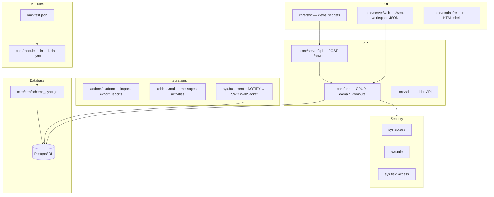

# Layered architecture

Sumeru is a **Go monolith**: PostgreSQL, XML views/metadata, and a **hybrid client** (SWC SPA inside a server-rendered shell). Addons register models and data without forking core.

## Layers

| Layer | Paths | Flow |
| ----- | ----- | ---- |
| **UI** | `core/swc/src/views/`, `core/server/web/workspace.go`, `core/engine/swcmeta/` | `GET /web/swc/workspace` → arch + records JSON → SWC; writes → `POST /api/rpc` |
| **Logic** | `core/orm/`, `core/server/api/dispatch.go`, `core/sdk/` | RPC → ACL/rules → SQL |
| **Modules** | `core/module/`, `addons/*/manifest.json` | `-i` / `-u` → depends order → schema sync → XML data (two-pass for view inherits) |
| **Security** | `core/orm/model_acl.go`, `core/orm/record_rules.go`, addon `security/` | Every search/CRUD |
| **Integrations** | `addons/platform/`, `addons/mail/`, `core/server/web/export_handlers.go` | Go services + RPC; not XML-only |
| **Database** | `schema_sync.go`, `orm.Registry` | Additive DDL on install and startup |

## Traces

### Open a record form

1. User opens a menu action → workspace loads `/static/swc/swc.js`.
2. Client requests `GET /web/swc/workspace` with model, view type, optional record id.
3. Server resolves merged `sys.view.arch`, reads row through ORM with field ACL and record rules.
4. SWC `FormView` renders arch + values.

### Save via JSON-RPC

1. `POST /api/rpc` — `create` / `write` on the model.
2. `dispatch.go` validates session or API key, applies ACL and record rules.
3. ORM executes SQL; hooks may publish bus events or mail side effects.

### Install an addon

1. `go run ./cmd/sumeru -- -c sumeru.conf -i contacts --stop-after-init`
2. Topological `depends`; `SyncRegistrySchemaForModule` for owned/extended models.
3. `data` XML: security, views, actions; **second pass** for `inherit_id` views (`core/engine/viewinherit/`).

## Extension mechanisms

| Mechanism | Where |
| --------- | ----- |
| View inherit (`inherit_id`, xpath) | `core/engine/viewinherit/`, e.g. `addons/contacts/views/core_partner_form_inherit_views.xml` |
| Model inherit (`inherit=` tag) | `core/modelreg/`, e.g. `addons/contacts/models/partner_extend.go` |
| Module `depends` | `core/module/install.go` |
| Related / computed fields | ORM field tags |
| Cross-module Go types | Generated `models/zrefs.go` in addon workspaces |

## See also

- [platform-status.md](platform-status.md) — maturity and kernel addons
- [sso.md](sso.md) — OIDC, TOTP
- [Published docs](https://projectmeru.github.io/sumeru/docs/core/architecture/overview.html)
- [Creating an addon](https://projectmeru.github.io/sumeru/docs/guides/build/creating-an-addon.html)
